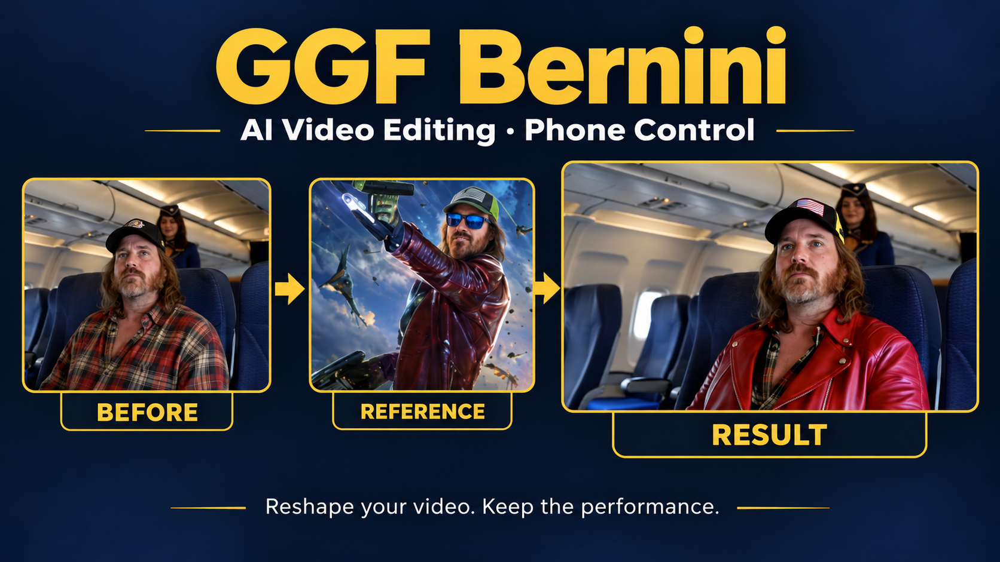

# Bernini Video Elements

## A Get Going Fast Application

### [Quick Setup Helper → GetGoingFast.pro/tools/bernini](https://getgoingfast.pro/tools/bernini/)

The guided Windows setup is a separate member download. This public repository provides the app source and manual setup instructions; it does not contain the installer ZIP or model weights.

Settings includes **Release models / free GPU memory** and **Stop server**.
Release keeps the app and phone connection open; Bernini already unloads its
worker after each finished job. Stop server asks for confirmation and requires
restarting RUN.bat on the local PC. Finish or cancel active generation first.

**Reshape your video. Keep the performance.**

Get going fast with [GGF tools and setup helpers](https://getgoingfast.pro)
and [The AI Hobby Guy on YouTube](https://youtube.com/@TheAIHobbyGuy).

Upload a video, optionally add a reference photo, and describe what should
change. Use the recommended Turbo edit. The app retains source
audio and saves each result with a unique download filename.

**Use Turbo for normal use. Full-size editing can take many hours, even with
24 GB of GPU VRAM.** Full-size rendering is tucked inside a closed Advanced
control with a prominent warning. Use it only with substantially more VRAM
and willingness to wait; more VRAM alone does not guarantee a fast render.
In a local 10-second RTX 4090 test, one 864 × 480 full-size sampling step took
over 2½ hours, while the complete 448 × 256 Turbo edit took about 13 minutes.
These observed timings are examples, not universal benchmarks.

The main page is kept simple. Settings contains model checks, sampling controls,
updates, and phone access. Choose Temporary public link, optionally set a
username/password, save, and restart. Local access always remains login-free.
Blank remote password disables login. Public links are temporary.

Displayed input orientation is automatically respected. Defaults: 3 seconds,
480 short-edge pixels full-size, half-size Turbo, six steps split 3+3. Custom
sizes and longer durations are accepted; zero duration means the rest of the
source. Longer clips require more VRAM, RAM and time. Whole clips are processed
in memory; unlimited duration is not a promise of unlimited memory.

Inputs/controls/results are persisted for the same browser/app address. A new
temporary public URL has separate browser site storage. Saved results remain
under `outputs`, which the app creates automatically. Temporary processing files
remain under `jobs`; older results already saved there remain available.
Persistent progress and a Stop button show/control owned generation.

Uses Bernini-R FP8 HIGH/LOW, UMT5 FP8, Wan 2.1 BF16 VAE, and the workflow's
LightX2V speed adapter. Pinned models total about 36.1 GiB. Windows 64-bit,
an NVIDIA GPU, and a CUDA-13-compatible driver are required; the installer
downloads its private Python 3.11 runtime automatically. Development used a
24 GB GPU.
No full ComfyUI installation or server is required. Selected inference core and
Bernini conditioning code are included with their upstream licenses.

See HANDOFF.md for what has actually been tested. Model quality and speed depend
on media and settings; do not treat a short smoke result as a universal benchmark.

## Manual installation from source

The member download is installer-only: extract it, run `INSTALL.bat`, then
`RUN.bat`. Setup downloads the individual app files from Codeberg, with GitHub
fallback, and provisions UV-managed Python 3.11, dependencies and model weights.
The ZIP never includes application source, models, an environment or runtime.
Keep all extracted root files together; setup creates `GGF-Bernini` beside them.

1. Install [Git for Windows](https://git-scm.com/download/win) and [uv](https://docs.astral.sh/uv/getting-started/installation/). Open **Command Prompt** in a writable folder, then clone the source:

   ```bat
   git clone https://codeberg.org/Cognibuild/GGF-Bernini.git
   cd GGF-Bernini
   ```

2. Create the private Python 3.11 environment and install dependencies:

   ```bat
   uv venv --managed-python --python 3.11 .venv
   uv pip install --python .venv\Scripts\python.exe torch==2.10.0 torchvision==0.25.0 torchaudio==2.10.0 --index-url https://download.pytorch.org/whl/cu130
   uv pip install --python .venv\Scripts\python.exe -r requirements.txt
   ```

3. Download the pinned model files from their upstream hosts and verify them with the app's downloader, then start the app:

   ```bat
   .venv\Scripts\python.exe download_models.py
   .venv\Scripts\python.exe app.py
   ```

Use Settings → Check for updates → Update and restart, or run `.venv\Scripts\python.exe update_app.py` with the server closed. Updates use archives generated automatically from the current Codeberg/GitHub repository. No source ZIP is manually rebuilt. Git is not required for updates. Models, settings, jobs and results are preserved; replaced source is backed up.

## Attribution

[Bernini conditioning](https://github.com/RH-RunningHub/ComfyUI-RH-Bernini),
the [source workflow bundle](https://github.com/gjnave/bernini-comfy-standalone),
and [Comfy inference code](https://github.com/Comfy-Org/ComfyUI) retain their
respective notices and GPL licenses. Model weights retain separate licenses;
their source URLs, pinned revisions and hashes are in model_manifest.json.
